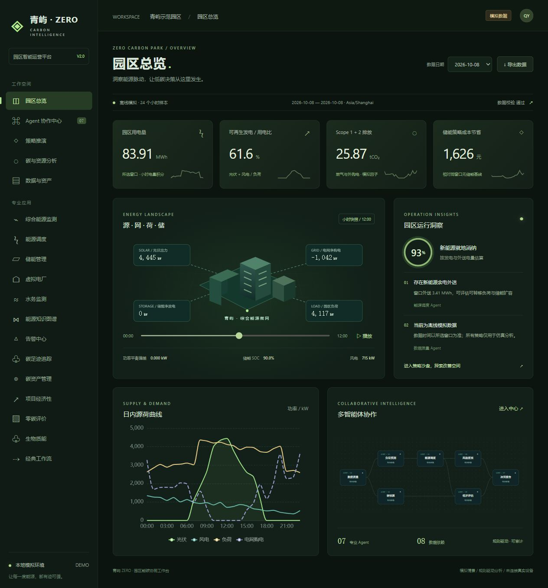

# zero_carbon_park_agent

零碳园区智慧能源与水务多智能体协作平台 —— 融合物理建模、时序预测与知识图谱，覆盖"源网荷储碳"全链路的一体化管理系统。

## V2 园区分析工作台

新增「青屿 ZERO」统一工作台：深色能碳驾驶舱、可播放的小时能源流、七 Agent 依赖图与事件回放、节点证据、历史运行、储能情景沙盘、碳与资源分析、数据质量及资产台账。

新工作台使用根目录 `data/operations.json` 的 720 条可复现模拟记录，运行存入 `data/operations_runs.db`。数据日期明确显示，排放因子与收益口径明确标注。Agent 为确定性领域计算，不需 LLM Key；原有专业应用继续保留。



```bash
python scripts/generate_operations_data.py
python -m unittest discover -s tests -v
python run.py run
# 另一个终端
cd frontend
npm run dev
```

访问 `http://localhost:5173`。首次启动先安装下文依赖。完整架构、API、计算公式、测试及局限见 [工作台架构说明](docs/operations-architecture.md)。

以下为原有专业模块说明，相关历史演示数据与新工作台的数据口径相互独立。

## 系统架构


系统采用分层架构：**展示层**（Vue 3 + ECharts）→ **网关层**（FastAPI + Uvicorn）→ **业务层**（LangGraph Agent 工作流 + 领域模型 + 调度引擎）→ **存储层**（SQLite + NetworkX 知识图谱）。

---

## 核心能力

### 领域模型层


基于物理机理建模，覆盖园区能源全节点：
- **源侧**：光伏（辐照-温度模型）、风电（风速-功率曲线）、生物质 CHP、市电
- **网侧**：微电网功率平衡、孤岛/并网切换、绿电直连溯源
- **荷侧**：7 类负荷柔性建模（关键/可转移/可削减/柔性），需求响应容量计算
- **储侧**：SOC/SOH 动态管理、循环寿命衰减、充放电效率
- **碳侧**：Scope 1/2/3 核算、碳配额/CCER/绿证管理、碳资产估值

### 服务层


- **智能监测**：覆盖光伏/风电/储能/电网/功率平衡/可再生占比的实时多级告警
- **调度引擎**：6 种策略（经济最优/价差套利/低碳优先/安全优先/平衡模式/削峰填谷），规则+优化混合驱动
- **园区数据服务**：全局单例 ParkDataService，统一管理所有节点状态，对外暴露 10 个 REST API

### AI Agent 层


基于 **LangGraph StateGraph** 编排 9 个专业 Agent，两条工作流闭环：

| 工作流 | Agent | 核心职责 |
|--------|-------|----------|
| 💧 水质异常 | 异常检测 → 根因分析 → 调度决策 → 任务派发 → 报告生成 | 全链路自动化处置，critical 级别支持人工审批 |
| ⚡ 能源优化 | 能源调度 → 储能优化 → VPP 聚合 → 报告生成 | 源网荷储协同优化，最大化可再生能源消纳 |

### 核心功能


- **新能源功率预测**：光伏/风电 24h 出力预测
- **生物质 CHP**：热电联产效率与沼气工程分析
- **多能互补调度**：光-风-储-荷协同优化 + 绿电溯源
- **虚拟电厂（VPP）**：分布式资源聚合、市场竞价策略
- **储能优化**：峰谷套利、需量管理、共享储能商业模式
- **CCUS 碳捕集**：捕集效率评估、利用路径优化
- **碳足迹追踪**：基于 NetworkX 知识图谱的 15 类节点 + 11 类关系，BFS 多跳能源血缘追溯
- **碳资产管理**：碳配额/CCER/绿证统一管理、CBAM 合规
- **工业节能诊断**：电机效率、余热回收、VFD 优化
- **经济性分析**：IRR/NPV/LCOE/投资回收期
- **零碳园区评价**：1 项核心 + 5 项引导指标，认证进度跟踪
- **水质预测与资源回收**：LSTM-Transformer 混合模型，72h 历史 → 24h 预测，COD/氨氮/硝氮联合预测
- **自然语言交互**：AI 驱动的园区运营数据查询

---

## 技术栈

| 层级 | 技术 | 用途 |
|------|------|------|
| AI Agent | LangGraph + LangChain | 多智能体工作流编排 |
| LLM | OpenAI 兼容 API | DeepSeek / GPT-4o-mini 推理 |
| 后端 | FastAPI + Uvicorn + Pydantic | RESTful API 服务 |
| 深度学习 | PyTorch | LSTM-Transformer 时序预测 |
| 图计算 | NetworkX | 知识图谱构建与 BFS 追溯 |
| 数据库 | SQLite + SQLAlchemy | 零配置业务数据存储 |
| 前端 | Vue 3 + Vite + Element Plus + ECharts | 驾驶舱大屏可视化 |
| 状态管理 | Pinia + Axios | 前端数据流管理 |

---

## 快速开始

### 环境要求

- Python 3.9+
- Node.js 18+

### 1. 安装依赖

```bash
# 后端
python -m venv venv
venv\Scripts\activate     # Windows
pip install -r requirements.txt

# 前端
cd frontend
npm install
```

### 2. 配置 API Key

```bash
cp .env.example .env
# 编辑 .env，填入你的 LLM API Key（可选，不填则使用本地模拟模式）
```

### 3. 初始化系统

```bash
python run.py init        # 初始化数据库 + 知识图谱
```

### 4. 启动服务

```bash
# 启动后端（http://localhost:8000）
python run.py run

# 启动前端（http://localhost:5173）
cd frontend && npm run dev
```

### 5. 演示工作流

```bash
python run.py demo        # 运行水质异常处置完整工作流
```

---

