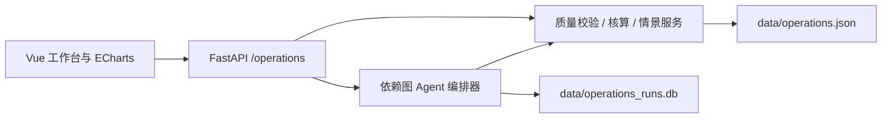

# 青屿 ZERO：园区分析工作台

## 范围与入口

新增五个工作区：`/` 总览、`/agents` 协作、`/scenarios` 策略、`/carbon-analysis` 碳与资源、`/data-center` 数据与资产。原有专业应用和 API 保留，原有模块使用其历史演示数据，不与新工作台混算。

这是面向演示和领域逻辑验证的离线分析项目，不是已接入现场设备的生产控制系统。新增 Agent 是具有明确输入输出的确定性领域工作者，不调用 LLM，不消耗 API 额度。旧工作流仍可使用原有 LLM 配置。

## 分层



- `scripts/generate_operations_data.py`：固定随机种子 42，生成 2026-09-09 至 2026-10-08 的 720 条小时记录、资产台账及参数。可独立重新生成，不覆盖原数据库。
- `backend/services/operations.py`：数据加载、源文件 SHA-256 指纹、质量校验、窗口选择、约束调度、成本与碳核算。
- `backend/services/operations_workflow.py`：节点依赖、并行执行、共享结果、执行事件、失败记录与 SQLite 持久化。
- `backend/api/operations.py`：类型化输入与范围校验，数据缺失和错误响应。
- `OperationsCenter.vue`：五个分析工作区；`OperationsChart.vue` 统一图表生命周期；`AgentNetwork.vue` 展示真实输入依赖及运行事件回放。

## Agent 契约

| Agent | 输入 | 输出 |
| --- | --- | --- |
| 数据质量 | 统一小时数据 | 完整性、时间连续性、数值与水量约束 |
| 负荷预测 | 校验通过的数据，所选日前最多 7 日 | 24h 负荷/光伏/风电历史同小时均值预测、留出日 MAPE |
| 碳核算 | 校验通过的数据 | 观测日无储能 Scope 1/2 基线、因子与边界 |
| 能源调度 | 预测曲线与策略 | 充放电、SOC、购售电、成本与排放 |
| 经济评估 | 调度结果、核算边界 | 同预测情景无储能基线对比 |
| 风险复核 | 调度序列 | 能量守恒、SOC、功率、期末能量、并网容量检查 |
| 决策报告 | 经济评估、风险结果 | 通过 / 需复核结论与可解释报告 |

独立就绪节点通过线程池并行执行。缺少历史数据时预测失败，依赖节点不再执行。失败记录仍落库。执行事件记录实际毫秒耗时；UI 将事件放慢回放，明确标注“回放”，不冒充实时 LLM 思考。风险检查不通过时状态为 `needs_review`，不会下发任何设备命令。

## 计算口径

- 每条采样代表 1 小时，kW × 1h 得到 kWh；MWh = kWh / 1000。
- 功率守恒：光伏 + 风电 + 购电 + 放电 = 负荷 + 充电 + 外送。
- 储能递推：下一时刻能量 = 上一时刻能量 + 充电 × 0.95 − 放电 / 0.95。
- SOC 20%–90%，初始 50%，额定功率 2000 kW；终端约束恢复到初始 SOC。容量 0 为无储能。
- `balanced`：余电/谷价充电，峰价或净负荷超过 3200 kW 时放电；`economic`：余电/谷价充电、峰价放电；`carbon`：余电充电、缺电放电。终端恢复约束可能带来购电。均为透明启发式，不声称全局最优。
- 成本 = 购电量 × 分时电价 − 外送量 × 0.25 元/kWh + 充放电总吞吐 × 0.05 元/kWh。无 CAPEX、需量费、碳交易、绿证、补贴与辅助服务收入。
- 策略节省 = **相同光伏/负荷/日期条件**下无储能成本 − 策略成本；负数明确表示成本增加。
- Scope 1 = 燃气 m³ × 2.16 kgCO₂/m³；Scope 2 = 购电 kWh × 0.58 kgCO₂/kWh。均为**演示假设**，不作为官方核算依据。外送不抵减排放，不含 Scope 3、抵消、绿证。
- 可再生发电/用电比 = min(100%, (光伏+风电发电量)/用电量)。不等于溯源绿电消费占比。
- 就地消纳率 = 1 − 外送电量/可再生发电量，为发电/外送口径估算；没有分来源的电池电量溯源，不应直接作为认证指标。
- 中水回用比 = 窗口回用水量/总用水量。
- 多日分析对整个窗口施加一次期末 SOC 约束；每日分组是窗口轨迹的聚合，与每天独立重置 SOC 的结果可能不同。

## API

| 方法 | 路径（前缀 `/api/v1/operations`） | 内容 |
| --- | --- | --- |
| GET | `/overview?day=2026-10-08&days=7` | 指标、时序、质量、资产、因子、数据指纹 |
| POST | `/scenario` | day、strategy、pv_scale、load_scale、capacity_kwh |
| GET | `/agents` | 节点与依赖边 |
| POST | `/runs` | day、strategy；执行并持久化分析 |
| GET | `/runs` | 最近 20 次执行 |
| GET | `/runs/{id}` | 完整输入、结果与事件 |

`day` 默认使用数据最新日，不使用系统当前时间代替数据时间；窗口前移不足天数时按实际可用日返回。缺文件返回 503，非法数据/参数返回 422，不存在的运行返回 404。

## 验证与运行

```powershell
python scripts/generate_operations_data.py
python -m unittest discover -s tests -v
python run.py run
# 第二个终端
cd frontend
npm install
npm run dev
```

如果 venv 基于 Conda Python，出现 `_sqlite3` DLL 错误时，可在已激活 Conda 环境的 PowerShell 中补充其动态库目录：

```powershell
$env:PATH = (Join-Path $env:CONDA_PREFIX 'Library\bin') + ';' + $env:PATH
.\venv\Scripts\python.exe -m unittest discover -s tests -v
```

自动测试覆盖极端容量与源荷情景的物理不变量、期末 SOC、零容量基线、核算对账、坏数据阻断、时间窗口、预测无留出日泄漏、依赖顺序、失败持久化与 API 参数边界。

后续接入真实系统时应补充身份权限、设备适配、时序存储、审计与备份、预测模型版本管理、任务队列/超时恢复，以及基于实际电价、并网协议和核算规范的配置管理。
